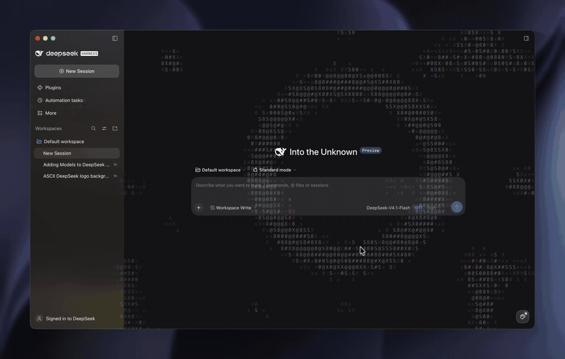

# ASCII Themes for DeepSeek Harness

Animated ASCII wallpapers for the DeepSeek Harness desktop app, with a theme
picker in the bottom-right corner.



[Full-quality video](docs/demo.mp4)

## Themes

- **Glyph Drift**: a ring of shuffling characters; a wave of glyphs sweeps in and drains away.
- **Signal Blocks**: blue, cyan and white pixel blocks race round a ring.
- **Orrery**: pixel-art sun with orbiting rune medallions, moons and embers.

## Install

You need Node 18+ and DeepSeek Harness Desktop (open it once so its profile exists).

```sh
git clone https://github.com/savka777/dsh-ascii-themes.git
cd dsh-ascii-themes
node scripts/install.mjs
```

Reload the app window. Click the palette button at the bottom right to pick a theme.

To uninstall: `node scripts/install.mjs --remove`

## Make your own theme

1. Add a draw function to `src/scenes.js` and list it in `THEMES`:

   ```js
   function drawMine(ctx, { t, w, h, cell, dark }) {
   	setFont(ctx, cell * 2, "center");
   	ctx.fillStyle = dark ? "rgba(255, 255, 255, 0.3)" : "rgba(0, 0, 0, 0.3)";
   	ctx.fillText("@", w / 2 + Math.sin(t) * 100, h / 2);
   }

   // in THEMES:
   { id: "mine", title: "Mine", accent: "#ffffff", draw: drawMine },
   ```

2. Build: `node scripts/build.mjs`
3. Check it in `preview.html?single=mine`, then reload the app.

Keep alpha low so chat text stays readable, and size things from
`Math.min(w, h)` so the scene also works as a small thumbnail.
[AGENTS.md](AGENTS.md) has the full rules.

## License

[MIT](LICENSE)
