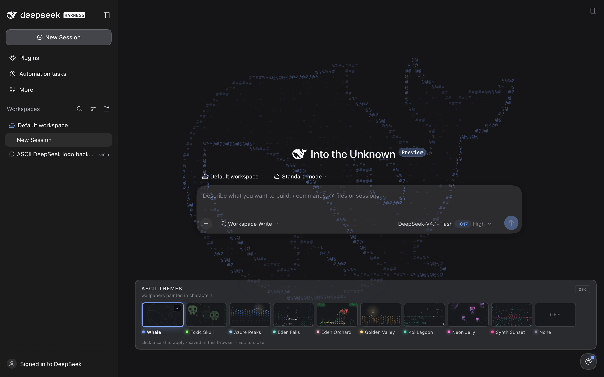

# ASCII Themes

A Harness Web UI plugin that paints a full-window ASCII wallpaper and adds a
floating gallery to switch between nine scenes plus an off switch. Click the palette button in the
bottom-right corner, pick a card, and the scene changes instantly; the choice is
remembered in this browser.



## Themes

| Id | Name | What it draws |
|---|---|---|
| `whale` | Whale | The DeepSeek whale as a breathing, shimmering ASCII field (default) |
| `skull` | Toxic Skull | Acid-green pixel skulls drifting through spores and acid rain, one huge ghost skull behind the UI |
| `peaks` | Azure Peaks | Receding blue mountain ranges with ridgelines, snow caps, valley haze and a still lake |
| `falls` | Eden Falls | Twin waterfalls between cypress and lush foreground foliage, with pool ripples and mist |
| `eden` | Eden Orchard | An apple tree, a watcher reaching up, and a serpent winding through the meadow |
| `valley` | Golden Valley | Warm layered hills, a low sun, light shafts, and wildflowers |
| `lagoon` | Koi Lagoon | Emerald wave bands, coral koi, fireflies, a moon and its reflection |
| `jelly` | Neon Jelly | Magenta jellyfish with glowing bells and flowing tentacles in a violet current |
| `synth` | Synth Sunset | A striped sunset sun, neon ridges, and a scrolling perspective grid |
| `none` | None | Turns the backdrop off without disabling the theme picker |

Each scene is drawn from glyphs on a transparent canvas and composited with
`plus-lighter` in dark mode and `multiply` in light mode, so it reads as a
wallpaper instead of a veil. The canvas is faded over the sidebar so navigation
text stays clean, and every scene honors `prefers-reduced-motion` by painting a
single static frame.

## The picker

- Trigger: a 38 px palette button at the bottom-right of the window (present on
  every page; the overlay keeps `pointer-events: none` except for the controls).
- Panel: a horizontal gallery with live animated thumbnails, the active card
  outlined in its accent color; `Esc`, a click outside, or the close button
  dismisses it.
- Selection persists in `localStorage` under `dsh.ascii-themes.active`.
- Theme previews render with supersampling (a small canvas is drawn at 3–4× and
  downscaled) because 5 px glyphs otherwise fade out in the rasterizer.

Previews from the running app: [whale](preview/app-whale.png) ·
[skull gallery](preview/gallery-skull.png) · [peaks](preview/app-peaks.png) ·
[eden](preview/app-eden.png) · [lagoon](preview/app-lagoon.png) ·
[jelly](preview/app-jelly.png).

## Repo usage

This folder is the canonical checkout and is ready for git. Clone it, then:

```sh
node scripts/build.mjs       # rebuild dist/ and preview.html
node scripts/install.mjs     # install into ~/.dsh/profiles/desktop (or --profile-dir)
```

`dist/` is committed so a clone can be installed without building first; rebuild
after editing `src/`. See [AGENTS.md](AGENTS.md) for the architecture and rules.

## Layout

| Path | Role |
|---|---|
| `src/scenes.js` | Scene library and `THEMES` table — the only file needed to add art |
| `src/renderer.js` | Canvas host: sizing, frame pacing, theme lookup, dark/light, reduced motion, supersampling |
| `src/client.template.js` | Client bundle: overlay canvas, trigger, gallery, persistence |
| `src/preview.template.html` | Static gallery preview (`?single=<id>`, `?light`) |
| `src/whale-mask.txt` | Whale density map used by the `whale` scene |
| `assets/icon.svg` | Plugin Manager icon |
| `scripts/build.mjs` | Builds `dist/` and `preview.html` |
| `scripts/install.mjs` | Links `dist/` into a profile and selects the bundle |
| `dist/` | Generated installable package |

## Build and install

```sh
node scripts/build.mjs
open preview.html            # gallery; add ?single=synth or ?light
node scripts/install.mjs     # or install dist/ with Plugin Manager
```

`node scripts/install.mjs --remove` uninstalls it. A rebuilt `client.js` is
served on the next page reload; adding a new bundle applies live.

## Adding a theme

1. Write a `draw(ctx, env)` scene in `src/scenes.js`. `env` is
   `{ t, w, h, cell, dark }`; paint with `glyph(ctx, char, x, y, [r,g,b], alpha)`
   and `setFont(ctx, px, align)`, and scale everything from `Math.min(w, h)` so
   the same scene works full-screen and as a thumbnail.
2. Add `{ id, title, accent, draw }` to `THEMES`. Keep alphas low enough that
   transcript text stays readable, and use `ink(dark)` for light-mode dimming.
3. `node scripts/build.mjs`, check `preview.html?single=<id>`, reload the app.

The standalone `plugins/dsh-ascii-whale` package is retired in the profile: its
whale is theme `whale` here, so only one backdrop is active.
